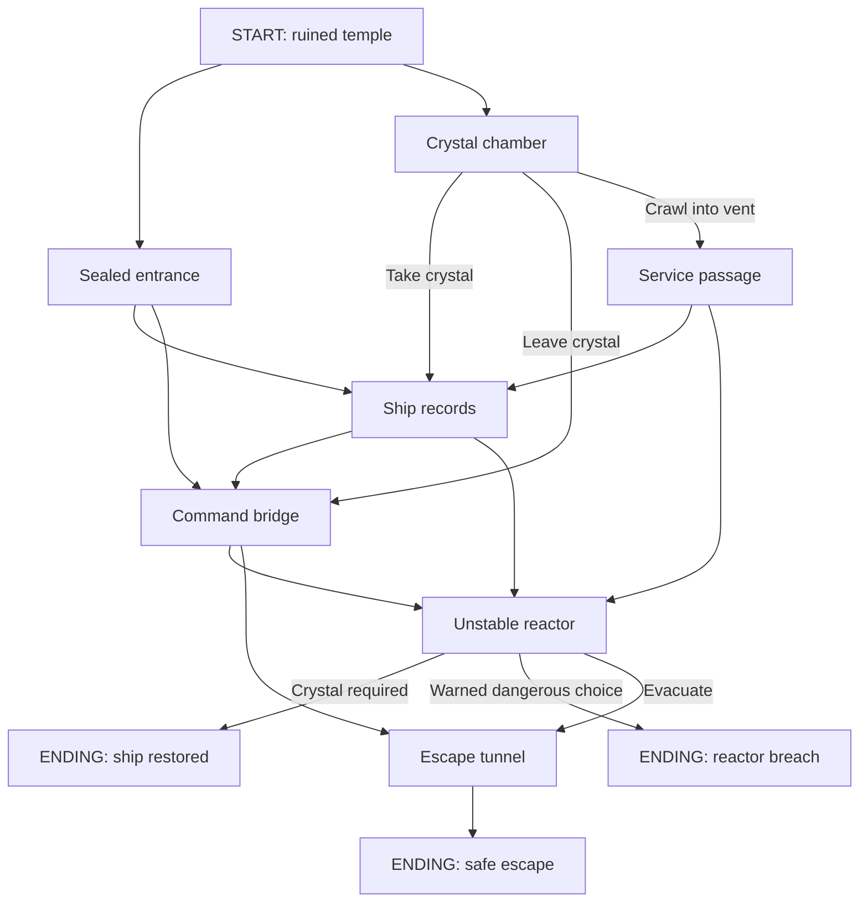
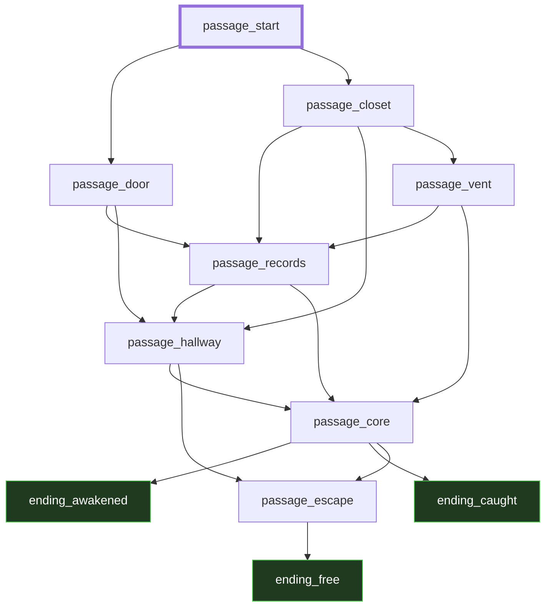

# Story Brief — M3A

- Your name: David Kilpatrick
- Story title: The Fallen Sky
- Route (Python / C++ / Twee): Python

---

## 1. Player evidence

- Player name: David Kilpatrick (solo option)

| ID | Question | Their answer |
|---|---|---|
| E-01 | What kind of stories do you like? | Science fiction, Fantasy and adventure |
| E-02 | How many minutes do you want to play? | About 5 minutes |
| E-03 | What do you not like in a story game? | Getting stuck in repetitive loops, Sudden failure without warning |
| E-04 | How do you want it to end? | A clear victory or failure, A surprising twist, A hopeful ending with some mystery left, Different outcomes based on my decisions |
| E-05 | Where will you play (phone, laptop, terminal)? | Desktop computer |
| E-06 | Which addition would most interest you in a bigger version? | A larger world with side quests |
| E-07 | Which adventure premise appeals to you most? | The Fallen Sky — discover an alien spacecraft beneath ancient fantasy ruins |

---

## 2. User stories

| ID | User story | Evidence |
|---|---|---|
| US1 | As a science fiction and fantasy player, I want to explore ruins hiding a spacecraft, so that I can discover how the two settings connect. | E-01, E-07 |
| US2 | As a player with about five minutes, I want a short adventure on my desktop, so that I can reach an ending before I need to stop. | E-02, E-05 |
| US3 | As a player who dislikes repetitive loops, I want my choices to move the story forward, so that I do not have to keep repeating scenes. | E-03 |
| US4 | As a player who dislikes sudden failure, I want a warning before a dangerous choice, so that I can judge the risk. | E-03 |
| US5 | As a player, I want different endings based on my decisions, so that my choices affect the outcome. | E-04 |
| US6 | As a player who enjoys exploring, I want side quests outside the ruins, so that I can discover more of the world. | E-06 |

---

## 3. Acceptance checks

| Story | Check | Pass / Fail (fill in after you build) |
|---|---|---|
| US1 | The game shows ancient ruins and a buried spacecraft and explains their connection. | Pass — checked in scripted routes; I accepted the game after playing. |
| US2 | I reach an ending on my desktop in less than five minutes. | Pass — my reported playtime was less than five minutes. |
| US3 | No story choice returns me to an already visited passage before an ending. | Pass — all 25 scripted routes move forward; I reported no repetition. |
| US4 | The reactor-breach choice has a warning before I select it and a safe alternative beside it. | Pass — verified on all nine scripted failure routes. |
| US5 | Different choices can produce a safe escape, a reactor breach, or a restoration ending with a hopeful twist and an unexplained signal. | Pass — all three endings were reached in scripted checks. |
| US6 | I can complete two optional side quests outside the main ruins. | Not built — cut from this release. |

US6 is deferred, so the current release has five acceptance checks.

---

## 4. Budget and cut list

My budget is 12 passages. The game uses 11: eight scenes and three endings.

**Keep**

| Order | Story | Why it is first (or next) |
|---|---|---|
| 1 | US1 | This is the setting I chose. |
| 2 | US3 | Repeated scenes were one of my stated dislikes. |
| 3 | US4 | Sudden failure was my other stated dislike. |
| 4 | US5 | Different outcomes make the choices matter. |
| 5 | US2 | A short map and short passages support my five-minute target. |

**Cut list** (at least one)

| Story | Why it waits | What would bring it back |
|---|---|---|
| US6 — Side quests | Two quests, each with an introduction and a resolution passage, would add four passages. That would bring the total to 15, above the limit of 12. | Reduce the main story to eight passages so four quest passages fit within 12, or expand the budget to at least 15 in a later version. |

---

## 5. Story map

| Passage name | What happens | Links to |
|---|---|---|
| passage_start | Enter the ruined temple through the sealed entrance or side chamber. | passage_door, passage_closet |
| passage_door | Discover metal beneath the stone and choose what to investigate. | passage_records, passage_hallway |
| passage_closet | Take the crystal, leave it, or crawl into the vent. | passage_records, passage_hallway, passage_vent |
| passage_vent | Discover the ship's service passage. | passage_records, passage_core |
| passage_records | Read how the temple was built around a crashed spacecraft. | passage_hallway, passage_core |
| passage_hallway | Find the bridge and learn that passengers remain asleep. | passage_core, passage_escape |
| passage_core | Restore the ship with the crystal, choose a warned dangerous launch, or evacuate. | ending_awakened (crystal required), ending_caught, passage_escape |
| passage_escape | Follow the safe tunnel out of the ruins. | ending_free |
| ending_awakened | Wake the travelers remembered as gods and discover another signal. | None — ending |
| ending_caught | A forced launch causes a reactor breach. | None — ending |
| ending_free | Escape and warn the village. | None — ending |

---

## Planning gate

I used the solo option and approved parts 1 to 5 before the build.

- [x] My player said yes. (No player: I said yes.)
- [x] Every user story has evidence and an acceptance check.
- [x] My map has a start and at least 2 endings.

My response: "yes, i would play this."

---

## 6. Ask before you build

**My question** (one thing I do not know yet): If I collect the crystal, will it still be available when I reach the reactor?

**Evidence I used** (map, table, or short test run): The approved map and the state table below, prepared before writing the game.

**What the evidence showed:** Collecting the crystal sets one Boolean to True. Later scenes do not change it, so the reactor can read it without backtracking. Skipping the crystal still allows a safe escape.

**Decision** (Ready / Revise / Split / Hold): Ready.

**One sentence why:** The map and state table show that the crystal can remain available without sending the player back through earlier scenes.

| What it is | Where it changes | Where it is read |
|---|---|---|
| has_crystal (H1 State) | main sets it to False before each playthrough; passage_closet sets it to True when the crystal is taken. | passage_core reads it to decide whether restoration is available. |

---

## 7. Where each job lives

- **Shows text** (print and input): The print calls display the scene words, and ask displays menus and reads input.
- **Applies rules** (decides what happens next): The choice conditions call the next passage, passage_core checks the crystal, and main controls replay.
- **Holds the story** (the passage words): The story words are strings inside the passage_ and ending_ functions in fallen_sky.py.

---

## 8. Decision after the playtest

- `story_check.py` findings left: 0.
- Acceptance checks passed: 5 of 5 kept stories; US6 remains cut.
- Where my player stopped or looked confused: I reported that nothing was confusing or repetitive.

**Decision** (Accept / Revise): Accept.

**Evidence:** My playtest took less than five minutes, and I accepted the game. The AI-run technical checks covered all 25 routes, all three endings, warnings before failure, crystal persistence, and replay reset. The supplied checker reports 11 passages, three endings, 17 links, and no findings.

---

## H3 Plan vs built (optional)

The final map keeps the same 11 passages and 17 links as the approved map. I kept those connections because they allow different endings without repeating scenes. The first map marks restoration as requiring the crystal; the checker omits that label, but the code enforces the condition.

## H6 Playtest log (optional)

H6 is not claimed; the two selected hooks are H1 and H3.

| Where did the player stop or get confused? | What I changed (or why I did not) |
|---|---|
| No confusion or repetition was reported. | I accepted the game without requesting a change. |
